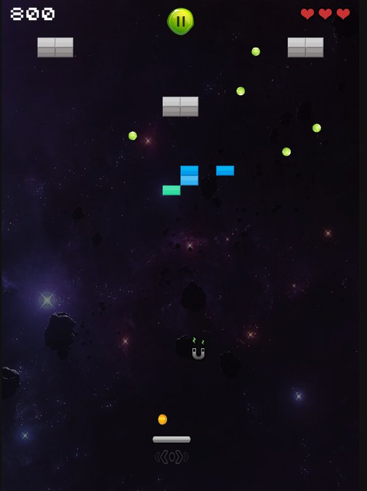
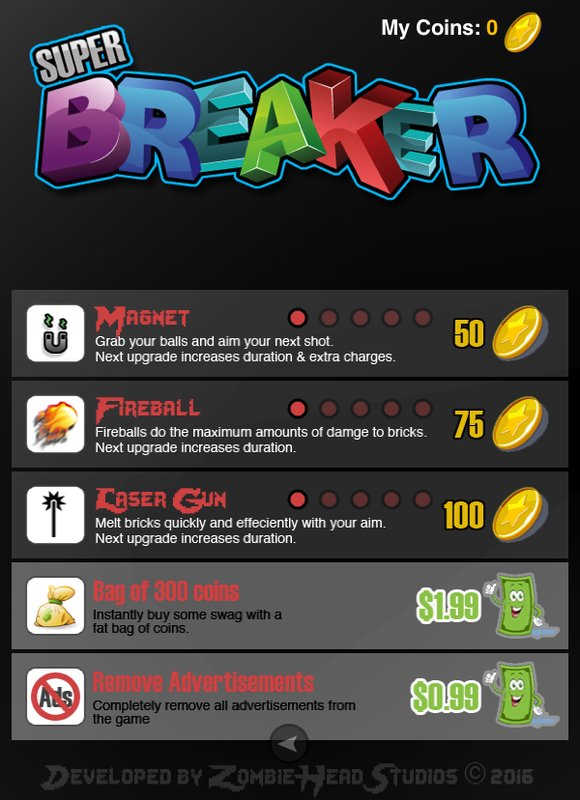

# Super Breaker

A brick breaker for browsers and phones, built with [Phaser 4](https://phaser.io), TypeScript and Vite. It ships as an installable PWA and as native iOS/Android apps through [Capacitor](https://capacitorjs.com).

## Quick start

Requires Node 20+ and pnpm 9 (`corepack enable`).

```sh
pnpm install
pnpm dev          # http://localhost:5173
```

| Script             | What it does                                          |
| ------------------ | ----------------------------------------------------- |
| `pnpm dev`         | Vite dev server with hot reload                       |
| `pnpm build`       | Typecheck, then build the PWA into `dist/`            |
| `pnpm preview`     | Serve the production build (service worker enabled)   |
| `pnpm test`        | Vitest unit tests, including validation of all levels |
| `pnpm lint`        | ESLint (flat config, typescript-eslint)               |
| `pnpm format`      | Prettier                                              |
| `pnpm cap:ios`     | Build, sync and open the Xcode project                |
| `pnpm cap:android` | Build, sync and open the Android Studio project       |

In dev builds the Phaser game is available as `window.game` in the browser console, which is handy for jumping to a level:

```js
game.scene.getScene('Title').scene.start('Play', { index: 24 });
```

To check performance on a phone, run `pnpm build && pnpm preview --host`, open the printed network URL with `?debug` appended, and watch the overlay: frame rate, CPU time per frame, physics bodies, live particles and render zoom. The game lowers its render resolution by itself (2x, then 1.5x, then 1.25x) when frames stay slow, and Settings has a Battery saver toggle that forces the lowest step and halves particles.

## Project layout

```
src/
  main.ts            Boots the save store, then the Phaser game
  config.ts          Layout constants, colors, powerup info, asset manifest
  core/              Pure, engine-free logic (unit tested)
    Difficulty.ts    Speeds, damage and lives per difficulty
    Economy.ts       Coin upgrade shop, powerup stats, drop table
    LevelParser.ts   Tiled map -> LevelSpec, plus validation
    SaveStore.ts     Versioned save data with legacy Cordova migration
  entities/          Ball, Paddle, Brick game objects
  systems/           Bricks, powerups, input, audio, juice (shake/hit-stop/particles)
  scenes/            Boot, Preload, Title, LevelSelect, Play, Hud, Pause, Results, Upgrades, Settings
  ui/                Buttons, panels and widgets drawn with Phaser graphics
  art/procedural.ts  Canvas-drawn fallbacks for any texture that fails to load
  art/backdrops.ts   Parallax worlds: layer order, scroll speeds, tints, light and particles
  platform/          Storage, haptics and app lifecycle (web and Capacitor)
public/assets/       Images, audio, fonts, tileset and levels
art-src/             Source sheets for the generated art, and the painted backdrop layers
scripts/process-art.py  Cuts the art sheets into game sprites and app icons
scripts/build-backdrops.py  Keys, loops and splits the backdrop layers
archive/             Retired levels and the old static backgrounds
tests/               Vitest suites
ios/, android/       Capacitor native projects
```

The playfield is 600 logical units wide and at least 800 tall; on taller screens it grows to fill the display. `src/core/Layout.ts` splits it into the HUD strip, an arena capped at 840 units (so the ball's trip to the bricks stays short) and, on touch devices, a control deck under the paddle that holds the ability and powerup buttons and a drag strip. Dragging anywhere on screen still moves the paddle. The canvas renders at up to 2x device pixel ratio, drops resolution automatically if frames run long, and respects safe-area insets. Portrait is enforced on native and a rotate prompt is shown on landscape phones.

## Gameplay

- **Difficulties:** easy, normal and hard change ball speed, brick damage, spin and paddle size.
- **Stars and coins:** levels award 1–3 stars based on lives left. Coins dropped by bricks are spent in the Upgrades shop. The **Powerups** tab upgrades magnet, fireball (duration and how many bricks it plows through before bouncing) and laser over 5 tiers; each tier costs base × tier, so the first ones only cost 8–12 coins. The **Abilities** tab unlocks Mega Bomb, Laser Sweep and Black Hole (Meteor, Lightning and Frenzy are owned from the start) and raises each ability through 3 tiers. Only owned abilities appear in the slot roulette.
- **Brick kinds:** normal, steel (unbreakable), explosive (chain-reacts in a radius), armored (needs extra hits, shows cracks), regen (clusters grow back unless cleared together), and moving (any brick can slide horizontally).
- **Powerups:** magnet, fireball (smashes through several bricks before bouncing), laser, multiball, bigger/smaller paddle, coin, shield, hyperspeed (faster physics and double damage), extra life, pierce and the mystery box.
- **Ability slots:** rainbow mystery boxes fill two slots through a Mario Kart style roulette. Tap a slot (or press Q/E) to fire Meteor Shower, Chain Lightning, Mega Bomb, Laser Sweep, Black Hole or Ball Frenzy. Players who are struggling, and levels with lots left, roll bigger area abilities (`src/core/Abilities.ts`).
- **Fever:** fast consecutive breaks fill the bar under the HUD. When it's full you get 8 seconds of fireball balls, double score and rainbow trails.
- **Pacing director:** `src/core/Pacing.ts` scores boredom from dry spells, a low break rate, the ball looping off the paddle, and the last bricks dragging on. It escalates from a homing nudge to a gift mystery box to a power surge that charges Fever. With 3 or fewer bricks left the ball homes in gently.
- When enough breakable bricks are gone (about 30% left, between 8 and 30 bricks), the rest collapse and fall so levels never drag on.

## Editing levels with Tiled

Levels are [Tiled](https://www.mapeditor.org) maps in `public/assets/levels/*.tmj`, listed in order in `public/assets/levels/index.json`. They share the external tileset `public/assets/tilesets/bricks.tsj`.

1. Open `superbreaker.tiled-project` in Tiled. It defines the custom property types used below.
2. Duplicate an existing level (for example `level24.tmj`), place bricks as tile objects on an object layer, and add the file to `index.json`.
3. Run `pnpm test` to validate it.

The playfield is 600 px wide; bricks are 30x16 and their bottom edge must be at y = 480 or above (`LEVEL_MAX_Y`) so the paddle has room even in the shortest arena. Formations should span the arena rather than hug the ceiling: the campaign levels run 16-25 rows tall, with a near band for quick breaks, a mid structure and a prize band at the top reached through 2-column lanes. `scripts/build-campaign.py` regenerates every campaign level except Demolition (level 24) and checks these rules. Each tile in the tileset has a default `kind` (tiles 0–15 are colors, 16–19 are steel, explosive, armored and regen). Per-object properties override the tile:

| Property     | Type             | Default | Meaning                                                                                                                                   |
| ------------ | ---------------- | ------- | ----------------------------------------------------------------------------------------------------------------------------------------- |
| `kind`       | `BrickKind` enum | tile's  | `normal`, `steel`, `explosive`, `armored`, `regen`                                                                                        |
| `powerup`    | `Powerup` enum   | random  | Guaranteed drop: `magnet`, `fireball`, `laser`, `balls`, `bigger`, `smaller`, `coin`, `shield`, `hyper`, `extraLife`, `pierce`, `mystery` |
| `health`     | int              | 100     | Hit points before breaking                                                                                                                |
| `armor`      | int              | 2       | Extra hits needed (armored bricks)                                                                                                        |
| `moveX`      | int (px)         | 0       | Slide distance to the right of the placed position                                                                                        |
| `moveSpeed`  | int (px/s)       | 60      | Slide speed                                                                                                                               |
| `regenDelay` | float (s)        | 4       | Time before a regen cluster grows back                                                                                                    |

Older levels using `breakable: false` or `healthPts` still load. The test suite rejects levels with no breakable bricks, bricks out of bounds (including their slide range), overlapping static bricks, or unknown kinds and powerups. In dev the game also logs parser warnings to the console.

## Art pipeline

Generated art lives in `art-src/` as sheets on a white background. `scripts/process-art.py` (requires Pillow) removes the background, slices each sheet on its grid, trims, resizes and writes the sprites and app icons into `public/`:

```sh
pip install pillow
python3 scripts/process-art.py
```

### Parallax backdrops

Each world covers ten levels: Hell Foundry (1–10), The Crypt (11–20) and The Mainframe (21–30). The menus show the world the player has reached. Like a vertical shooter, a static sky sits behind painted layers that scroll upward at different speeds, so the view sinks through the world. Back to front: far, fog, mid, fog, near, with a light glow and drifting particles in between. Fever speeds the scroll up, explosions flare the light, and nearer layers slide against the paddle. Reduced motion freezes the scroll; battery saver drops the fog layers.

The source art is in `art-src/backdrops/<world>/`:

- `sky.jpg` is the static plate.
- `far.jpg`, `mid.jpg` and `near.jpg` are painted on a flat chroma key: green, or magenta for the Mainframe, whose art uses cyan.
- Optional `<layer>_b.jpg` sections continue a layer below the first, which doubles its loop length.
- `key.jpg` is the style reference the layers were painted from.

Paint the layers 720 wide (9:16), with detail toward the edges and the middle kept empty, and avoid the key hue in the artwork. Horizontal shapes like ledges, bridges and beams sell the vertical motion better than columns and chains.

`scripts/build-backdrops.py` (numpy, Pillow) does the processing:

- keys out the background and grades each layer for depth (far layers hazier, near layers darker)
- joins the sections and the loop's ends along the least visible cut
- splits layers with an empty middle into left and right strips
- generates the fog from looping noise

It writes WebP into `public/assets/images/backdrops/` and the manifest `src/art/backdrops.json`. Scroll speeds, tints, light and particles are tuned in `src/art/backdrops.ts`. A world is loaded when a scene needs it and the others are released, since each takes about 18 MB of GPU memory.

```sh
python3 scripts/build-backdrops.py                     # all worlds
python3 scripts/build-backdrops.py hell --stills /tmp/hell.jpg --video /tmp/hell.mp4
```

`--stills` and `--video` composite the world with sample bricks to check readability and the loop.

Any texture missing at runtime is replaced by a procedural canvas drawing (`src/art/procedural.ts`), so new brick kinds or powerups can be prototyped before their art exists.

## Mobile builds

The native projects in `ios/` and `android/` are committed. After changing web code:

```sh
pnpm cap:ios        # requires Xcode
pnpm cap:android    # requires Android Studio
```

App id is `com.zombieheadstudios.superbreaker` (see `capacitor.config.ts`). On native, saves go through Capacitor Preferences, haptics use the Haptics plugin, the status bar is hidden, and the game auto-pauses when the app goes to the background. App icons come from `public/icons/icon-1024.png`.

## Save data

Saves are stored under `superbreaker.save` (localStorage on web, Preferences on native) as versioned JSON. On first launch, progress from the old Cordova version (its localStorage keys) is migrated automatically.

## Classic screenshots

The original 2015 Cordova version:



