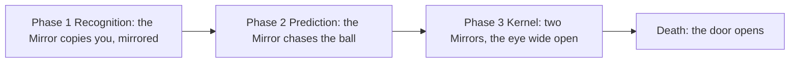

# World 3 finale: the Overseer and its Mirror

A handoff for a fresh agent. It holds the agreed design for the game's last boss, the framework
work the design needs, the asset pipeline, and everything learned building the Angler (World 2's
finale) that is not obvious from the code. Read it all before starting. Read
[README.md](README.md) (the rules), [authoring.md](authoring.md) (the boss API, written from the
code) and the newest [STATUS.md](STATUS.md) entry ("Vesper, the Lure") too.

The rules in README.md apply: the code is the source of truth, invent nothing, no `Math.random`
or timers in boss code, no shortcuts to green, verify before you claim. Where this document and
the code disagree, the code wins; note it in STATUS.md.

What is a fact here was read in the code on 2026-11-22. What is a proposal says so.

## 1. Where it sits

- World 3 is the Mainframe, levels 21 to 30 (`WORLD_IDS = ['hell', 'crypt', 'mainframe']` in
  `src/art/backdrops.ts`, `LEVELS_PER_WORLD = 10` in `src/core/Difficulty.ts`). It is the last
  world, so this boss is the game's final fight: the stop after level 30, map `boss30.tmj`.
- The bosses so far: the Crucible (after 5, `src/bosses/crucible.ts`), the Warden (after 10,
  `warden.ts`), the Angler (after 20, `angler.ts` and `anglerRig.ts`). The Angler is the closest
  template: a rig-drawn body, its own track, beat-locked attacks, its own hazard art and scenery.
- The story so far, from `src/cutscenes/chapter3.ts` (Chapter III, before level 21): the Angler's
  lantern broke and freed Vesper. Lightning shows an ark under the lake; it wakes as the
  Mainframe, a cyan eye (`cs_mainframe_eye`, `cs_mainframe_face`), and says "Seal two of three...
  broken", "Thank you, Breaker", and "You were not made to escape. You were made to open the
  door." Vesper says it was counting every wall the Breaker broke. She goes into the Breaker's
  light ("Then don't let it see you coming. Take my light."), and the Breaker falls into the
  Mainframe. Its voice lines `vo_mainframe_01` to `04` exist.

## 2. The concept (agreed with the user)

A hybrid: **the Watcher** (the Mainframe's eye is the arena) with **the Mirror Breaker** (a
corrupted copy of the player's paddle is its weapon).

**Name.** The Overseer, epithet "The Third Seal". Boss id `overseer` (keep it distinct from the
`mainframe` world and scenery ids).

**Story (a default; confirm or change it with the user at the first check-in).** The Overseer
recorded every move the Breaker made and built a Mirror Breaker from them, so it can open the
door without the Breaker. The player breaks the eye that drives the Mirror. Dying, the Overseer
opens the door anyway, onto daylight: the surface the Breaker was never meant to reach. Vesper's
light, inside the Breaker, is the one thing it never counted. An `ending` scene follows the fight.

**The arena.** A giant lens fills the top of the field, set into a server cathedral that extends
the Mainframe backdrop. The iris has shutters that open on the beat. The eye is the weak part.
Along the paddle line, a heatmap glows where the Overseer has learned the player stands.

**The weapon.** A corrupted copy of the player's paddle rides a rail under the eye. It is a steel
part ("Steel deflects and takes no damage", `PartDef.kind` in `BossDirector.ts`), so it bats the
ball back. Getting the ball past it into the eye is the core duel. Each phase moves it by a
different rule, and each rule has a weakness the player can learn.



### Why it is fun (the rationale to keep while tuning)

- **An opponent you can read.** The Mirror is deterministic with a known bias. Learning its rule
  is the skill: in phase 1 you steer it; in phase 2 you outpace it.
- **A model of you that you can see.** The habit heatmap punishes standing in one place and
  rewards mixing up positions (a mixed strategy beats a predictor), and it shows its reasoning
  openly, so the player is never punished by something they could not see.
- **Echoes of earlier bosses.** Each world's finale pattern comes back corrupted. A player who
  learned the Warden's volley or the Angler's false lights already knows the answer: the finale
  rewards the whole campaign.
- **Risk for reward.** Catchable slag, and the stun it buys, is a choice, not a chore.
- **Every attack leaves an opening** (authoring.md section 6): dodge, then the eye is yours.

### Phases (pools and numbers are starting points to tune)

Pools are plain hits on Normal. The plan for the Angler aimed at 3 to 4 minutes on Normal; the
finale may run a little longer. For scale: Crucible 18/27/27, Warden 20/48/62, Angler 20/28/30.

**Phase 1, Recognition (pool about 24, intensity low).**
- The Mirror stands at `FIELD_WIDTH - paddle.x` on its rail, closing on it at a capped speed
  (say 380 px/s on Normal). The player steers it: stand left and the eye's right side is open.
- `scan`: two or three column beams step across the field toward the player's most-used zone,
  one a beat. Opening: the lens shutters open, the eye is locked.
- `packet`: the Mirror fires shots straight down from where it stands, which is the mirror of
  where you stand. Move and the shots move away from you. Opening: eye.
- `recall-warden`: a corrupted echo of the Warden's skull volley (skulls take a life; at most
  `MAX_SKULLS`, never with a jam). Opening: eye.

**Phase 2, Prediction (pool about 32, intensity mid).** Enter scene: the eye "recompiles"; the
heatmap comes up.
- The Mirror chases where the rising ball will cross its rail (a straight-line forecast with wall
  bounces), at a capped speed (say 300 px/s). A cyan ghost line on the rail shows its target.
  Every fourth return it feints (moves the wrong way first, about 300 ms), with a glitch flicker
  and a sound as the tell. Steep shots off the paddle's edge outrun it.
- Habits drive targeting: attacks aim at the player's two most-used zones.
- `recall-angler`: false lights (decoy shots) with one real slag; catching the slag sends it back
  at the Mirror, which stuns it (frozen, dimmed) for two beats: one clear shot at the eye.
- `overwrite`: the Overseer rebuilds a row of a past level as ordinary bricks with `spawn`
  (`ArenaBrick = Omit<BrickSpec, 'id'>`), between the Mirror and the paddle.
- `scan`, `packet` stay in the deck.

**Phase 3, Kernel (pool about 36, intensity high).** Enter scene: the arena falls into a data
tunnel (a new `kernel` scenery, or the Mainframe backdrop's fall; see section 5), the eye opens
fully, the Mirror splits in two.
- Two half-rail Mirrors: the left copies you (mirrored), the right chases the ball. The gap
  between them is your shot.
- `recall-crucible`: a rain of slag to catch and return at the eye.
- `purge`: beams sweep across the field; the safe gap is always in the player's least-used zone,
  so mixing positions all fight long pays off here.
- `total-recall`: a medley, one echo after another, at the end of the deck.

**Death.** The eye cracks, the Mirror dissolves into Vesper-coloured light, the room relights
(`s.lighting.celebrate()`, see section 6), the door opens. Then the `ending` scene.

### Parts (a proposal; fit it to the art with `&debug`)

The field is 600 px wide, cells `BW = 30` by `BH = 16`, 20 columns. The Angler's skull sat at
col 6, row 2.

| Part | Col, row | Size | Kind |
| --- | --- | --- | --- |
| `eye` | 7, 3 | 6x4 | weak 3 |
| `lidTop`, `lidBottom` | 6, 2 / 6, 7 | 8x1 each | steel; poses close them over the eye |
| `mirror` | 8, 12 | 4x1 | steel; steered (section 3) |
| `mirror2` | phase 3 only | 2x1 | steel; steered |

Poses: `shut` (lids over the eye), `open` (lids apart), `wide` (lids gone, phase 3). Openings use
`{ pose: 'open', lock: 'eye' }`. The rig draws the rail, the lens, the shutters and the heatmap.

## 3. Framework work the design needs

Each item: what the code does now (fact), what to add (proposal), and its tests.

### 3.1 A boss stop after the last level

- Now: `validStops` in `src/core/Campaign.ts` drops any stop with `after >= levelCount`
  (`if (after! < 1 || after! >= levelCount || ...) continue;`). With 30 levels, a stop after 30
  is ignored. `stepAfter` from `{ index: 30, stop: 'boss' }` returns `{ index: 31 }`.
- `Results.ending()` (`src/scenes/Results.ts`) already plays the scene placed `after` the
  campaign's last step when `d.next` is undefined, so `{"id": "ending", "after": "boss30"}`
  routes once the stop is allowed and `next` is undefined after it.
- Add: allow `after === levelCount` in `validStops`; make the step after a final stop "none"
  (check how Play computes `next` and how WorldPath, Briefing, Title and SaveStore treat a
  skull node after the last level). Tests in `tests/campaign.test.ts`.

### 3.2 Steering a part live

- Now: `BossBody.move(offset, step)` moves every part toward `homeX/homeY + drift + posed[id]`
  with one shared `approach(..., step)`, where `step = speed * tick / 1000` from the director.
  Only named poses (`s.pose(id)`) change `posed`. Parts are bricks in an Arcade group
  (`immovable: true`) moved by position; the Angler's parts, swaying under its phases' `sway` and
  `figure8` motions, already collide with the ball this way.
- Add: something like `BossStage.steer(partId, { dx, dy } | null, pxPerSec)`, a live offset that
  overrides the pose for one part at its own speed, cleared by `null` and by the phase changing.
- Check first, in a lab map: the ball against a fast-moving steel part (tunnelling at the
  Mirror's top speed, and whether the bounce should take some of the Mirror's motion, as the
  paddle gives the ball "english"). Moving normal bricks use body velocity instead
  (`updateMover` in `BrickSystem.ts`); compare.
- Tests: a steered part reaches its target at its own speed and returns to the pose when released.

### 3.3 Live balls on the stage

- Now: `BossHost.balls(): readonly Ball[]` exists, and attack plans get `BossView.balls`, built in
  `BossDirector` from `host.balls()` (not attached, with velocity). `BossStage` has no ball list.
- Add: `BossStage.balls()` returning the same shape as `BossView['balls']`, so the boss's `on()`
  or a per-frame hook can steer the Mirror. Check whether `BossDef` has a per-frame hook; if not,
  add one (for example `tick?(s: BossStage, dt: number)`) rather than steering from a tween.

### 3.4 Habits

- Add: the director keeps a histogram of the paddle's x over the fight clock (6 bins of 100 px,
  each frame adding `dt` to the bin under the paddle's centre, decaying with a half-life of about
  20 s), exposed as `BossView.habits: number[]` (normalised to sum 1) for plans and
  `BossStage.habits` for the heatmap. Fight clock only, so it pauses with the game and is the
  same for a given input on every device.
- Tests in `tests/boss.test.ts`: it fills the bin you stand in, decays, and plans that read it
  still pass `planProblems` (keep `SAFE_GAP`, 200 px, free).

### 3.5 Echo looks (optional)

- Now: `HazardLooks` (`src/systems/HazardSystem.ts`) is one set per boss: `shot`, `slag`,
  `splash`, `skull`, `decoy`, `beam`, `shotGlow`, `fx`. A shot can carry `look: 'decoy'`.
- Add, if the echoes should wear other bosses' corrupted art: a `look: 'echo'` on shots and skulls
  with `HazardLooks.echo`. Otherwise give the Overseer its own glitched skull and decoy art.

## 4. Assets and the pipeline

Every generator used for the Angler, and where its output goes.

- **Concept art (check-in 1).** Ludo `generateWithStyle`/`createImage` with references from the
  Mainframe backdrop and `cs_mainframe_eye`. Show the user two or three takes before building.
  Ludo credits were about 23 before the Angler work spent some; call `getAccount` first and spend
  sparingly. Ludo URLs expire in 7 days: download at once. The project skill is
  `.claude/skills/ludo/SKILL.md`; `.env` holds the key (`set -a && source .env && set +a`).
- **Rig art.** Sheets in `art-src/bosses/overseer/`, sliced and keyed by `scripts/build-bosses.py`
  (see its `"angler"` entry: `kind: "sheet"`, `grid`, `frame`, `enclosed`) into
  `public/assets/images/bosses/overseer/`. The rig slices with `sliceSheet` (see `anglerRig.ts`).
  GenerateImage (the Cursor tool) also works for stills and supports 9:16.
- **Scenery.** A `kernel` entry in `scripts/build-backdrops.py` `WORLDS` (the `abyss` entry shows
  `from:` reuse of another world's layers, `stills`, fog layers), registered in
  `src/art/backdrops.ts` (`SCENERY_IDS`, `WORLD_LOOKS`) and added to the FX `only:` lists and to
  `SCENERIES` in `src/scenes/FxLab.ts` where `mainframe` appears. Build the phone set with
  `/usr/local/bin/python3.14 scripts/build-backdrops.py kernel`, then the 16:9 set (section 6).
- **Music.** A new `scripts/build-<boss>-music.py` in the style of `scripts/build-angler-music.py`
  (imports `build-boss-audio.py` helpers; writes the mp3 and matches a `MusicTrack` cue sheet like
  `src/bosses/anglerMusic.ts`: `bpm`, `beat`, `click`, segments `rise`, `low`, `mid`, `high`,
  moods keyed by the level-song moods that `BOSS_MOOD_FALLBACK` maps to). Fast horror synthwave,
  around 120 BPM. Set `music: { key, track }` and `beatLock` on the `BossDef`.
- **Sounds.** Append an Overseer section to `scripts/build-boss-audio.py` (as the Angler's
  `angler/*` block), output to `public/assets/audio/boss/overseer/`, keys in `AUDIO_ASSETS` in
  `src/config.ts`, and update the boss sound count in `tests/bosses.test.ts` (it was 49 after
  the Angler).
- **Voice.** The Mainframe's lines go through the `MACHINE` ffmpeg chain in
  `scripts/build-cutscene-audio.py` (`SOURCED` entries like `("vo_mainframe_01",
  "vo/vo_mainframe_01.mp3", MACHINE, -14, 0.4, 1, "96k")`, sources in `art-src/cutscenes/vo/`).
  How those sources were generated is in commit `b25ceda` (`git show b25ceda --stat`, and the
  Chapter III chat transcript); match that voice. Vesper's boss lines used MiniMax `mmx` speech,
  voice `English_SereneWoman` (speech-2.8 has no "whisper" emotion; "sad" worked).
- **Cutscenes.** A pre-fight scene (`the-door`, before `boss30`) and the `ending` (after
  `boss30`), in `src/cutscenes/`, registered in `src/cutscenes/index.ts`, placed in
  `public/assets/levels/index.json` `scenes`. Plates go through `scripts/build-cutscene-art.py`
  (`ART` entries). `src/cutscenes/lure.ts` is a short template; `chapter3.ts` a long one.
- **Map.** `public/assets/levels/boss30.tmj` (copy `boss20.tmj`: properties `boss`, `darkness`,
  `lightsOut`, `title`), the Boss enum value in `superbreaker.tiled-project`, `BOSS_IDS` in
  `src/core/Boss.ts`, `BOSSES` in `src/bosses/index.ts`, and the stop in `index.json` `bosses`.

## 5. The Angler as a map of files

| File | What it holds |
| --- | --- |
| `src/bosses/angler.ts` | `BossDef`: parts, poses, attacks (`AttackDef` with `plan`), phases (`setup`, `pose`, `motion`, `deck`, `enter`), `on()` reactions, cutscenes as `{ lengthMs, cues: [{ at, run(s) }] }`, `hazards`, `music`, `trophy`. |
| `src/bosses/anglerRig.ts` | `BossRig`: draws lit images over the parts (`lighting.addLit`), lights (`lighting.addLight`), `place(center, spots, dt)` each frame, `beat()`, `broken(part)`, reduced motion via `ctx.calm`. |
| `src/bosses/anglerMusic.ts` | The track's `MusicTrack` cue sheet. |
| `src/fx/library/angler.ts` | FX presets (`ANGLER_FX`), registered in `src/fx/library/index.ts`. |
| `src/systems/ParallaxBackdrop.ts` | Scenery hooks the boss drives: `reflect`, `surge`, `snuff`, `crossStill`, `pulse`. |
| `src/cutscenes/lure.ts` | The pre-fight scene. |
| `public/assets/levels/boss20.tmj` | The arena map. |

## 6. Pitfalls learned on the Angler

- A phase's `setup` and `pose` run in `begin()`, after its `enter` cutscene. A cutscene that
  should show the new pose must call `s.pose(...)` itself.
- Rerunning `scripts/build-boss-audio.py` re-encodes every committed boss mp3. Restore the ones
  you did not mean to change with `git checkout -- public/assets/audio/boss/<file>`. Sounds are
  seeded by their index in the list: only ever append.
- In a lights-out arena the aftermath (about 12 s while the victory theme rings out) is black
  unless the death relights the room: `s.lighting.celebrate()` in a death cue.
- Targets in a dark arena need their own glow (the Angler's pods were invisible until they got an
  additive glow and a stronger light).
- The reveal's health fill was fixed to stop at 1; nothing to do, but don't be surprised by old
  logs.
- The 16:9 set: `tests/backdrops-hd.test.ts` fails for a new scenery without one. Upscale with
  Real-ESRGAN (`realesrgan-ncnn-vulkan -i in.jpg -o out.png -n realesrgan-x4plus -m <models>`; it
  was unpacked at `/tmp/realesrgan`, which a reboot clears; the macOS release is on the
  xinntao/Real-ESRGAN GitHub releases page) into `/tmp/backdrop-hd/<world>/`, including the
  sources of any `from:` world, then `/usr/local/bin/python3.14 scripts/build-backdrops.py --hd
  --src /tmp/backdrop-hd <world>`. Each image takes about a minute.
- Python for the audio scripts: a venv with numpy (`/tmp/sb-venv/bin/python` was used; recreate
  it if `/tmp` was cleared). ffmpeg is `/usr/local/bin/ffmpeg`.
- Fairness (`planProblems`, run by `tests/bosses.test.ts` over every boss): see authoring.md
  section 6. A beam hits on any overlap with the paddle (`HazardSystem.advance`), so a "stand in
  the gap" design needs a gap wider than the paddle.
- Cutscene tests (`tests/cutscenes.test.ts`): 20 s to 2 min, shipped assets only, known fx and
  sfx keys, ending with the letterbox at 0 and a neutral grade. The boss flash test counts every
  `impact` and `glimpse`: no more than two whole-screen flashes in any second.
- Known failures in committed code, not yours: `tests/skills.test.ts` "readies the gun more often
  than bullet time", and lint's unused `h` in `src/art/procedural.ts`.

## 7. Work order

Mark each in the todo list as you go. Two check-ins with the user use AskQuestion.

1. **Framework**: sections 3.1 to 3.4 (3.5 if chosen), with tests. Prove the steered Mirror in a
   lab map before building content.
2. **Concept (check-in 1)**: concept art takes, and the story default; the user picks.
3. **Scenery**: `kernel` (phone and 16:9 sets), its scenery hooks.
4. **Rig art and rig code**: eye, shutters, lens, Mirror, rail, heatmap, ghost line, lights,
   glows, reduced motion.
5. **Boss definition**: parts, poses, attacks, phases, `on()`, `boss30.tmj`.
6. **Phase 1 playable (check-in 2)**: the user plays `?stop=30` and judges the feel.
7. **Audio**: track and cue sheet, sounds, voice.
8. **Cutscenes**: entrance, phase scenes, death, `the-door`, `ending`.
9. **FX**: presets for the Overseer's hazards and death.
10. **Campaign**: `BOSS_IDS`, `BOSSES`, Tiled enum, `index.json` stop and scenes, campaign and
    cutscene tests.
11. **Verify** (section 8), docs (authoring.md if the API grew), the STATUS.md entry.

## 8. Before calling it done

- `pnpm typecheck`, `pnpm lint`, `pnpm test`: only the two known failures.
- authoring.md section 8's checklist.
- In a browser: every phase with `&phase=N`, every attack with `&attack=<id>`, Easy, Normal and
  Hard, reduced motion on, the 16:9 stage (a 1600x900 viewport), the whole run from `the-door`
  through the `ending` and back to the menus.
- Sound: say plainly that synthesized sound has not been heard, unless the user listened.
- A human Normal run for length, or say it is not done.

## 9. Kickoff prompt

> Build the World 3 finale boss in this repository. Before anything else, read
> `docs/boss-fights/world3-finale.md` in full, then `docs/boss-fights/README.md`,
> `docs/boss-fights/authoring.md`, and the newest entry in `docs/boss-fights/STATUS.md`. Follow
> the work order in section 7, including both check-ins with the user. Finish with an entry in
> STATUS.md. Do not commit unless asked.

## Appendix: the headless harness

Playwright drives the dev server (`pnpm dev --port 5199 --strictPort`) in headless Chrome, turns
on god mode, steers the paddle to the lowest ball, logs the boss's phase and health each second,
saves screenshots, and lists console errors. Save it as `/tmp/sb-pw/boss.mjs` in a folder with
`playwright-core` 1.56 installed (`npm i playwright-core@1.56`).

```bash
node boss.mjs "http://localhost:5199/?stop=30" 40 p1                  # 40 s, shots every 3 s
EVERY=1 node boss.mjs "http://localhost:5199/?stop=30&attack=scan" 20 a   # one attack
DIFF=hard node boss.mjs "http://localhost:5199/?stop=30" 90 hard
RM=1 node boss.mjs "http://localhost:5199/?stop=30&phase=3" 70 rm    # reduced motion, to the award
NOSKIP=1 node boss.mjs "http://localhost:5199/?stop=30" 16 ent       # watch the entrance unskipped
W=1600 H=900 node boss.mjs "http://localhost:5199/?stop=30&phase=3" 12 wide   # 16:9 stage
```

Space is pressed every second, which skips scenes (`NOSKIP` waits for control). The settings
are set after the first click, before Play builds the boss. `?scene=<id>` plays a cutscene alone.

```js
import { chromium } from 'playwright-core';

const url = process.argv[2] ?? 'http://localhost:5199/?stop=20';
const seconds = Number(process.argv[3] ?? 40);
const tag = process.argv[4] ?? 'boss';
const every = Number(process.env.EVERY ?? 3);
const width = Number(process.env.W ?? 720);
const height = Number(process.env.H ?? 1000);

const browser = await chromium.launch({
  executablePath: '/Applications/Google Chrome.app/Contents/MacOS/Google Chrome',
  headless: true,
  args: ['--autoplay-policy=no-user-gesture-required', '--use-angle=metal', '--enable-gpu'],
});
const page = await browser.newPage({ viewport: { width, height }, deviceScaleFactor: Number(process.env.DPR ?? 1) });
const errors = [];
page.on('pageerror', (e) => errors.push('pageerror: ' + (e.stack || e.message)));
page.on('console', (m) => {
  if (m.type() === 'error' || m.type() === 'warning') errors.push(m.type() + ': ' + m.text());
});

await page.goto(url);
await page.waitForFunction(() => window.game?.isBooted, null, { timeout: 30000 });
await page.mouse.click(width / 2, height / 2);
await page.evaluate(async () => {
  const { save } = await import('/src/services.ts');
  save.state.settings.godMode = true;
}, null);
if (process.env.DIFF) {
  await page.evaluate(async (d) => {
    const { save } = await import('/src/services.ts');
    save.state.difficulty = d;
  }, process.env.DIFF);
}
if (process.env.RM) {
  await page.evaluate(async () => {
    const { save } = await import('/src/services.ts');
    save.state.settings.reducedMotion = true;
  });
}

// Autopilot: the paddle follows the lowest falling ball.
if (!process.env.MANUAL) {
  await page.evaluate(() => {
    setInterval(() => {
      const play = window.game.scene.getScene('Play');
      if (!play?.paddle || !play.sys?.isActive?.() || !play.balls?.children) return;
      const balls = play.ballList.filter((b) => b.active);
      const ball = balls.sort((a, b) => b.y - a.y)[0];
      if (ball) play.paddle.targetX = ball.x + Math.sin(performance.now() / 700) * 18;
    }, 30);
  });
}

let last = null;
for (let s = 0; s < seconds; s++) {
  await page.waitForTimeout(1000);
  const st = await page.evaluate(() => {
    const b = window.boss;
    const play = window.game.scene.getScene('Play');
    const hud = play?.hud?.boss ?? null;
    return {
      frame: window.game.loop.frame,
      scenes: window.game.scene.getScenes(true).map((x) => x.scene.key).join(','),
      cs: window.cutscene?.time?.() ?? null,
      boss: b ? { phase: hud?.phase, hp: hud && +hud.health.toFixed(2), shown: hud?.shown, ctl: hud?.control } : null,
    };
  });
  const stuck = last && st.frame === last.frame;
  console.log(`${s + 1}s f=${st.frame} cs=${st.cs && Math.round(st.cs)} ${st.scenes} ${JSON.stringify(st.boss)}${stuck ? ' <-- STOPPED' : ''}`);
  if ((s + 1) % every === 0 || stuck) await page.screenshot({ path: `/tmp/sb-pw/${tag}-${String(s + 1).padStart(2, '0')}.png` });
  if (process.env.EVAL && s === Number(process.env.EVAL_AT ?? 0)) await page.evaluate(process.env.EVAL);
  if (!process.env.NOSKIP || st.boss?.ctl) await page.keyboard.press('Space');
  last = st;
}
console.log('--- errors ---');
console.log([...new Set(errors)].join('\n') || '(none)');
await browser.close();
```

Notes: the dev server reloads on file edits, which cuts a running capture short; rerun it. A
headless run can hang at `browser.close()` after its last screenshot; the screenshots are still
good. Stitch screenshots into a contact sheet with Pillow to review a run at a glance.
