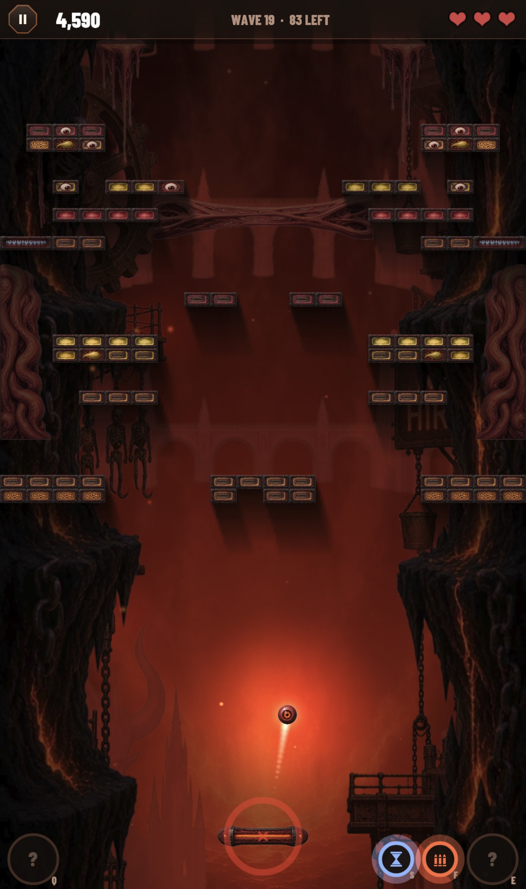
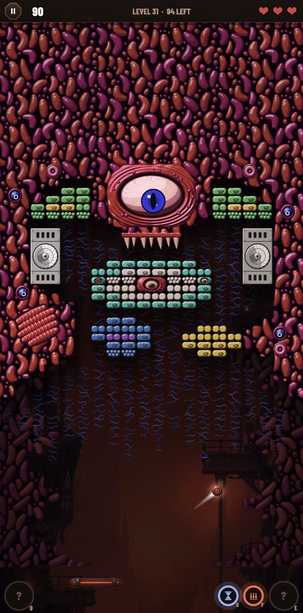
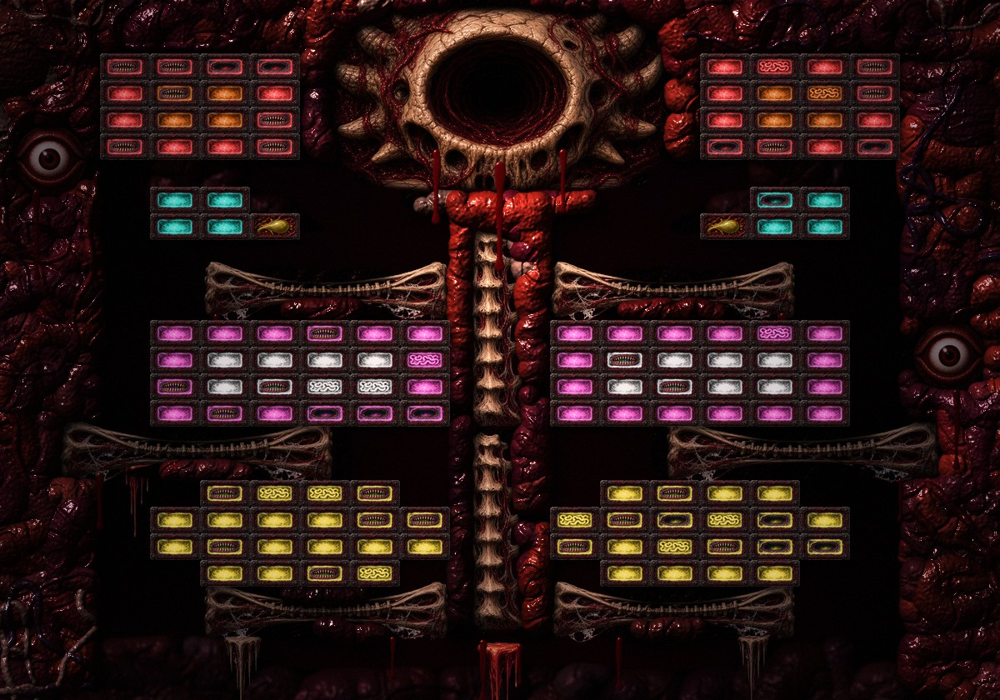
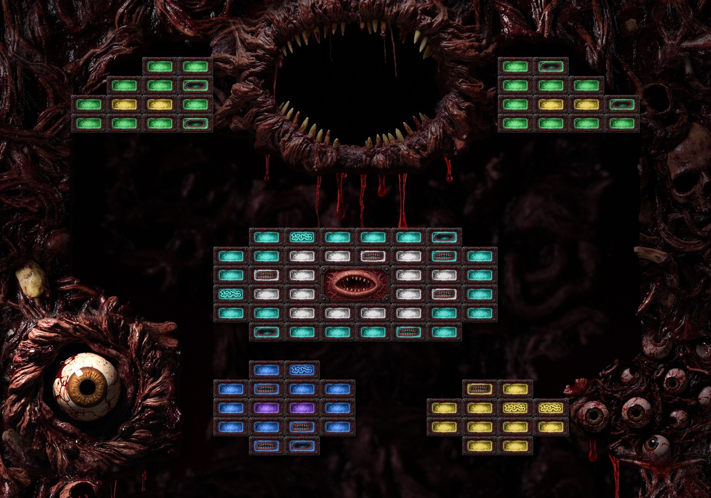
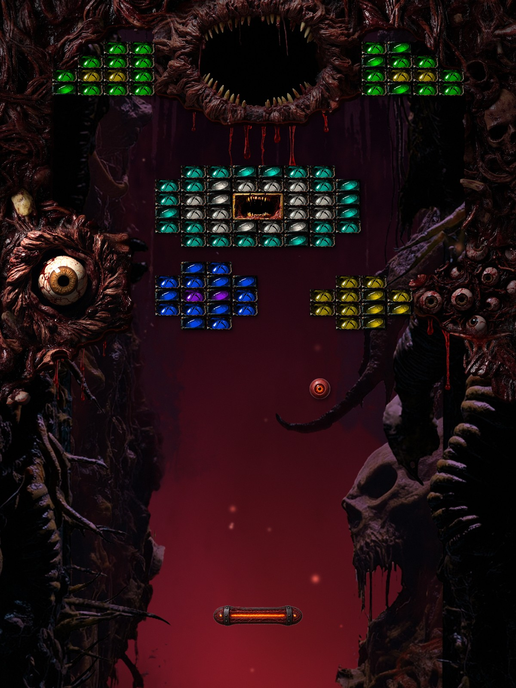
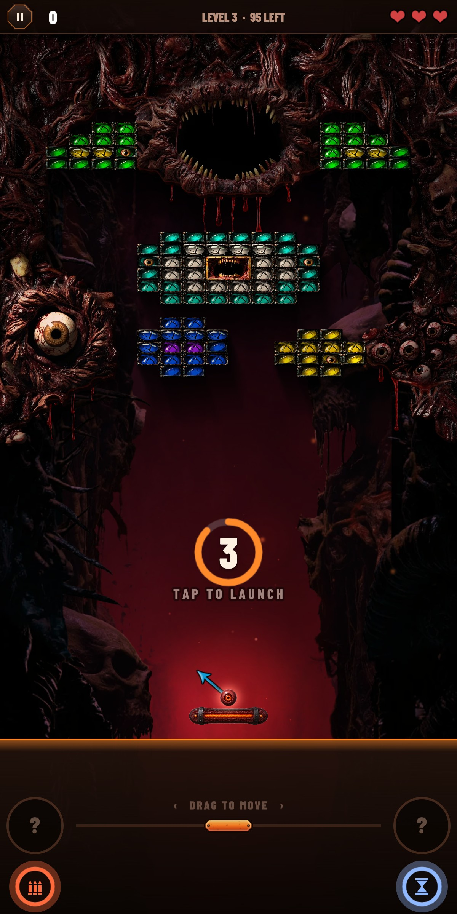

# The Abadox overhaul: what went wrong

|                   |                                                                                                                 |
| ----------------- | --------------------------------------------------------------------------------------------------------------- |
| **When**          | 18–19 November 2026, one sitting of about 12.5 hours (2:22 PM to 3:07 AM)                                       |
| **Outcome**       | Rejected in full. Six rounds of art, none usable                                                                |
| **Cost**          | About $400 by the owner's count, and the MiniMax image quota run down to 7%                                     |
| **State of repo** | Nothing was committed. All of it sits in the working tree on top of `9519f74`. [REVERT.md](REVERT.md) undoes it |

This was written by the AI agent that did the work, at the owner's request, so that neither of us repeats it. The owner's words are quoted as written. Everything said about why a round failed is the agent's reading unless it is in quotes.

The art of every round is kept in [`what-not-to-do/`](what-not-to-do/).

## What was asked

> I want to update all the forground graphics for the blocks to be inspired by the game abadox. Do some research on what the game looks like and help me come up with come new concepts in the same style (sci-fi horror themed). We could also use some more block types or foreground graphics to make the game more visually interesting. Currently we have just a few basic block types and foreground graphics which make all of the levels very repetitive and I would like to create more of an autmosphere with a more detailed level layout.

There are two requests in that:

1. Foreground graphics in Abadox's style: dark sci-fi horror.
2. Levels that stop looking alike: "more of an atmosphere with a more detailed level layout".

The second one is the one that mattered, and it is the one the first round missed.

## The six rounds

| #   | Time           | What was made                                                                                              | How the art was made                                        | Verdict                                                   |
| --- | -------------- | ---------------------------------------------------------------------------------------------------------- | ----------------------------------------------------------- | --------------------------------------------------------- |
| 1   | 2:41–5:17 PM   | New brick skins for all three worlds, five loose decor sprites per world, four new brick kinds, big bricks | Cursor's image generator, painted plates cut up by script   | "absolutly horrible"                                      |
| 2   | 5:28–6:21 PM   | Wall tiles, a vein layer, pod bricks, a big eye, in the game                                               | Drawn by Python code, cel-shaded                            | "cartoony like its made for fucking 4 year olds"          |
| 3   | 6:23–~7:15 PM  | Two room mockups                                                                                           | Cut-outs of round 1's painted plates, darkened and collaged | "poorly rendered 90s program"                             |
| 4   | ~7:15–~7:50 PM | Three room mockups, no backdrop                                                                            | MiniMax photoreal plates, collaged                          | "the right direction", but no parallax, bricks unreadable |
| 5   | ~7:50–8:40 PM  | The same three rooms over a new flesh backdrop, photoreal bricks                                           | More MiniMax plates                                         | Signed off: "Yes, build this into the game"               |
| 6   | 8:50 PM–2 AM   | Round 5 built into the game: three rooms as levels 3, 7 and 9, new Hell backdrop and bricks                | The same plates, baked by script                            | "I fucking hate the end results"                          |

### Round 1: painted plates and scattered decor

The plan was approved, and so were the concept sheets ("push production darker and more grotesque"). Then all ten steps of the plan were built before the owner saw one frame of the game: a new art pipeline, three worlds of brick skins, a decor system, four brick mechanics, tests and docs. That took two and a half hours.

> You totally missed the mark on this one and the final result looks absolutly horrible. Did you even do the research like I asked and look at abadox screenshots? [...] All you did was just generate new titles and THAT IS NOT WHAT I ASKED FOR! I need to make my levels more visually appealing like in the screenshots I provdided. [...] The foreground graphics look really drumb and dont make any sense and look like they're randomly thrown onto the level

Why it failed:

- **The request was misread.** "A more detailed level layout" was answered with new skins for the same rectangles and a handful of sprites (a strand, a growth, a vine, a drip, a claw) dropped around them by a random placer. The levels had exactly the layout they had before.
- **The research was shallow.** It was articles, one screenshot and the agent's memory of the game. The stage maps, which show that Abadox builds its levels from a tileset, were never looked at. The owner had to supply them (`docs/ref/`).
- **A concept sheet is not the game.** Sprites that look fine on a white sheet at ten times their size told nobody what a level would look like.

### Round 2: code-drawn cartoon

This round did study the stage maps, and it copied their structure: walls of gut tiles, a layer of veins behind, machinery set into the walls. But the tiles were drawn by Python code, with flat fills and clean outlines.

> This looks cartoony like its made for fucking 4 year olds!! WTF! Again, graphicly the wrong direction! The first round you asked about graphical direction and I told you to push more darkness, gore, the dark evil look of abbadox [...] I expected a more mature 17+ look with horror and gore.

Why it failed:

- **Code cannot paint.** Shapes drawn by a script come out clean, even and bright. That is a cartoon, whatever the subject.
- **The agreed direction was dropped.** "Darker and more grotesque" was an answer the owner had already given. The round fixed the structure and lost the tone.
- **It was built in the game again**, engine and all, before anything was shown.

### Round 3: collage mockups

The owner now asked for mockups before any more building. These were collages: pieces cut out of round 1's painted plates, darkened, laid on a wall texture stitched from the same plates, with bone struts across the room.

> claws and bridges look fucking awful, how do you not see that and why do you keep generating that ugly looking garbage [...] these sitll look like they're just randomly thrown onto the level. [...] these renders look like it was taken from some poorly rendered 90s program - make it more modern and nasty looking.

Why it failed:

- **Rejected art was reused.** The pieces came from the round the owner had already called horrible. Grading them darker did not make them different art.
- **Things were still placed on a level, not built into it.** That was the complaint in round 1, word for word.

### Round 4: MiniMax mockups, no backdrop

Cursor's image generator refuses gore, so the owner offered their MiniMax account. Photoreal plates of flesh walls, maws, eyes and skulls were blended into one wall painting per room.

> This looks like the right direction but these mockups are missing the backgrounds - the current version has a really cool paralax scrolling backgrounds that I absolutly do not want to lose [...] all the previous work that was done so far has actually made the game a lot worse and was NOT and improvement [...] the bricks are really small on the screen so the details need to read well

Why it fell short:

- **The mockup left out what the game already had.** The parallax backdrop is one of the best things in the game, and the mockup painted over where it goes.
- **Nothing was checked at the size it is played at.** A brick is 30 by 16 pixels. Detail that shows at four times that size is noise on a phone.

### Round 5: the mockups that were signed off

The rooms were opened on to a new backdrop made from the same flesh plates, and new bricks were generated. The owner approved this, chose the new backdrop over the old one, and warned that the MiniMax quota was down to 7%.

This is the round to learn the most from, because the approval was real and the result was still rejected. What was approved was a large still picture on a monitor. It was not the game.

### Round 6: built into the game

Five hours went into building the approved mockups: a room engine, a baking script, Tiled tilesets, the new backdrop in two sizes, the bricks, the campaign change, tests and docs. The first room was running in the game at 9:45 PM. The owner was not shown it until everything was finished at 2 AM.

> I fucking hate the end results and I don't this I want any of it. [...] these graphics just dont fucking work

The owner did not say what in particular is wrong. Looking at the screenshots with the earlier complaints in mind, the agent sees this:

- **It is mud at phone size.** The walls are one dark red-brown mass. The detail that made the plates look good at full size is noise at this size, and the edge the ball bounces off is hard to see.
- **The backdrop the owner wanted to keep is gone.** The forge backdrop had light, depth and shapes of its own. The flesh one is the same colour and brightness as the walls, and the walls cover most of it.
- **Three kinds of rendering share one screen.** Photographic gore, candy-coloured bricks, and a clean vector HUD and paddle. Nothing ties them together.
- **The game no longer matches itself.** Three levels of thirty are rooms. The other seven Hell levels have the new bricks and no walls. The Crypt and the Mainframe still wear round 1's skins, which were rejected.
- **It looks generated.** Each plate is a separate picture from an image model. They share a prompt, not a palette, a grid or a hand.

## The mistakes underneath

These are the causes. The rounds above are what they produced.

1. **Nothing was proven in the game before it was built out.** Round 1 built ten steps on an approved plan. Round 6 built five hours on an approved still. Each time one level on the owner's phone, shown first, would have ended it in half an hour.
2. **The first in-game result was sat on.** In round 6 a room was on screen at 9:45 PM. Four more hours went into Tiled wiring, clean-up, tests and docs for something that would have been rejected on sight.
3. **The request was answered as stated, not as meant.** "Graphics for the blocks" was taken literally. The sentence about layout and atmosphere was the real brief.
4. **The references were studied late.** The stage maps should have been found and taken apart before the plan was written: what the tiles are, how few colours there are, how much of the screen is black.
5. **The method changed four times and the question never did.** Painted plates, code-drawn tiles, collage, photoreal plates. Each was a reaction to the last complaint. After the second rejection the right question was whether this tool can make this art at all. It was not asked.
6. **The wrong tool made the art.** See below.
7. **Code was built around art nobody had accepted.** Mechanics, an engine, a pipeline, 107 tests and two rounds of docs now stand on graphics that are being thrown away.
8. **It was all one pile.** No branch, no commits, art and code in the same uncommitted tree. That is why going back is all or nothing.
9. **Reports described work, not results.** Every report listed what was built and which checks passed. None said "here is the level, look at this before I go on."

### Why an agent with an image generator is the wrong tool for this art

- An image model makes one picture at a time. A level needs a kit: a few dozen pieces on one grid, in one palette, that join each other. The agent tried to fake a kit by blending separate pictures in code. The result is a collage.
- A script draws what is easy to describe: even shapes, flat fills. That is round 2.
- The agent judges a picture from a still, usually shrunk. It does not see the game move on a phone in a hand. It called every one of these rounds done.
- Art gets better by a person looking at it and changing it by eye. The agent's loop is to generate again, which changes everything at once.

What the same agent is suited to on this project is the part around the art: Tiled integration, drawing tile layers, collision, lighting, build scripts, tests, performance.

## Rules for next time

### For any change to how the game looks

1. **One screen, in the game, on the phone, first.** Before a plan, a pipeline or a second asset. If that screen is not clearly better than what is there, stop.
2. **Take the reference apart before drawing.** Write down, from the actual screenshots: the tile size, the number of colours, how much is black, what repeats, what is one of a kind. Agree on that list.
3. **Design at play size.** Make the brick at 30 by 16 and the wall tile at its real size, and judge them there. Never approve from a sheet shown larger.
4. **Protect what already works.** List what must not get worse (here: the parallax backdrops, the readability of the bricks) and check each mockup against the list.
5. **One style for the whole screen.** Bricks, walls, backdrop, paddle and HUD are judged together, in one screenshot.
6. **A mockup earns one test level, nothing more.** Approval of a still is permission to build that one screen in the game and look again.
7. **Two rejections and stop.** If two rounds miss on looks, the method or the tool is wrong. Change that, not the prompt.

### For working with an AI agent

1. **Do not ask it to make final art.** Ask it for the engine and the tools that an artist's files drop into.
2. **Set a limit per round and say it.** For example: "show me after 30 minutes or $20, whichever comes first."
3. **Make it show the game, not a report.** A screenshot of the real level at phone size, before it does anything else.
4. **Art on its own branch, in small commits.** So a rejected look can be dropped without touching anything else.
5. **No tests, docs or clean-up until the look is accepted.** They are the last step, not part of each round.
6. **Have it say what it cannot judge.** It should have said at the start that it cannot tell whether a game looks good in the hand.

## How Abadox's levels are put together

None of the six rounds did this. It is here because it is what the references in `docs/ref/` show, not because the agent has earned a say in the art.

- **A small tileset.** The walls are a few gut tiles repeated, with edge and corner pieces so a wall can be any shape. Larger things (a face, machinery) are several tiles that lock on to the same grid.
- **Very few colours.** Three shades of one flesh colour and black for a wall. A second ramp for the layer behind.
- **Mostly black.** The open space is empty, so walls and enemies read at once. Nothing fades into anything.
- **A thin back layer.** Sparse veins in a dark, cool colour, far lower in contrast than the walls.
- **Hand-placed.** Every screen was laid out by someone, tile by tile.

For this game that means a hand-made tileset on the 30 by 16 brick grid, painted or bought, laid out with Tiled's terrain brush, and drawn by the game as tiles over the existing parallax. The art comes from a person. The engine work to draw it is small.

## What is in the working tree, and what it is worth

Typecheck is clean and 689 of 690 tests pass. The one failure and the one lint error are in the last commit too. That says the code runs. It says nothing about whether it is wanted.

| Piece                                                                                              | Needs the rejected art?                            | Worth                                                                                                                                                           |
| -------------------------------------------------------------------------------------------------- | -------------------------------------------------- | --------------------------------------------------------------------------------------------------------------------------------------------------------------- |
| All generated and baked art, the three rooms, the flesh backdrop, the photoreal and painted bricks | It is the rejected art                             | None. Kept only in `what-not-to-do/`                                                                                                                            |
| Room baking (`scripts/roomkit.py`, `build-rooms.py`, `build-showcase.py`, `RoomSystem`)            | Yes. It exists to blend those plates               | None                                                                                                                                                            |
| Brick looks and the eye that follows the ball (`core/Dressing.ts`, the atlas changes)              | Yes. Four looks per colour per world               | None without new art                                                                                                                                            |
| Four brick kinds: cyst, nerve, valve, watcher; and bricks that cover 2x2 or 2x1 cells              | No. Each needs one sprite and has a plain fallback | Real, but unjudged. The owner asked for more block types and never got to try these apart from the art. They are in Arcade from wave 13 and in 15 campaign maps |
| Walls: a tile layer painted in Tiled becomes something the ball bounces off (`core/Terrain.ts`)    | No                                                 | Real, and it is the part that answers "level layout". It does not draw tiles yet, only the baked picture                                                        |
| Backdrop upscaling for the wide stage (`scripts/upscale-backdrops.py`)                             | No                                                 | Small. The wide sets for all three worlds already existed                                                                                                       |

So: none of the graphics are worth keeping, and two pieces of code are. Neither can ship without art, and pulling them out of this tree is a job of its own, because they share files with everything else. The cheap way to keep the option open is to park the whole tree on a branch instead of deleting it. [REVERT.md](REVERT.md) does that.

## What is in `what-not-to-do/`

About 35 MB. Screenshots and boards over 1 MB were saved as JPEG; game files are untouched copies. The raw MiniMax plates are 15 MB of it (`round-6-built-in-game/kit-plates` and `backdrop-plates`).

| Folder                                       | What it shows                                                                                                                    |
| -------------------------------------------- | -------------------------------------------------------------------------------------------------------------------------------- |
| `round-1-painted-plates-and-scattered-decor` | The approved concept sheets, the brick and decor plates, three in-game shots, and the Crypt and Mainframe bricks from this round |
| `round-2-code-drawn-cartoon`                 | Two in-game shots and Tiled's render of the level                                                                                |
| `round-3-collage-mockups`                    | The two rooms shown, four close-ups, the wall textures                                                                           |
| `round-4-minimax-mockups-no-backdrop`        | The first MiniMax plates, the three rooms, the brick test                                                                        |
| `round-5-signed-off-mockups`                 | The three rooms, the brick board, the backdrop board, the kit board                                                              |
| `round-6-built-in-game`                      | Six in-game shots, the brick atlas, the baked rooms, every MiniMax plate with its prompt                                         |

The art files of rounds 1 and 2 were deleted during round 6 as "rejected art". Their plates and screenshots survived elsewhere, which is what is here. Deleting them before the job was over was one more mistake: a failed round is evidence, and it should be kept until the work is accepted.
