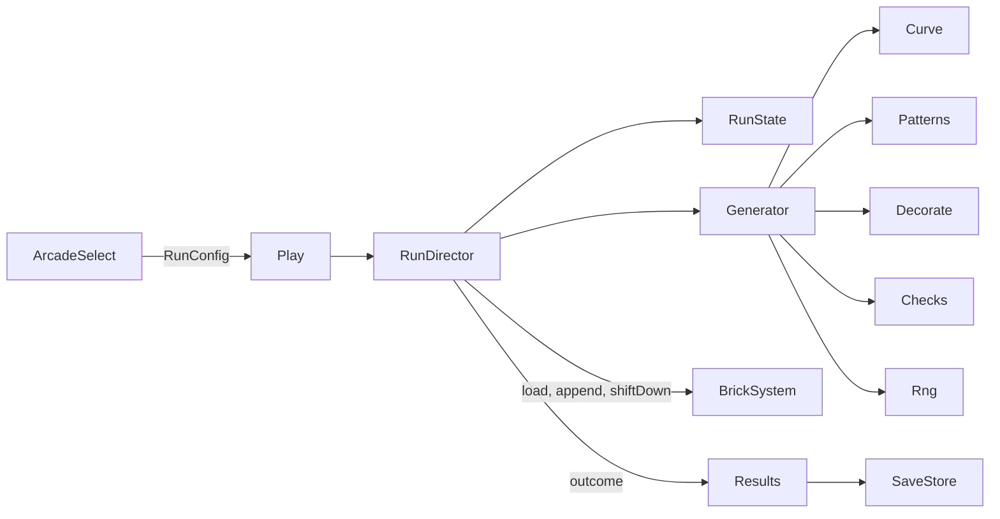

# Arcade mode: procedural levels

Arcade is the mode where the levels are generated instead of authored. A run never has to end: the generator keeps producing boards that get harder, and the player chooses whether the run lasts until they're out of lives, for a fixed number of rounds, or against the clock.

This document describes the first version and the ideas for growing it. The code lives in `src/core/procgen/`, `src/core/Run.ts` and `src/systems/RunDirector.ts`.

## Concepts

| Term  | Meaning                                                                                           |
| ----- | ------------------------------------------------------------------------------------------------- |
| Run   | One Arcade session, from the first launch to game over or the goal.                               |
| Loop  | How bricks arrive: **Waves** or **Descent**.                                                      |
| Goal  | When the run ends: **Endless**, **Rounds** or **Timed**.                                          |
| Tier  | The difficulty step the generator is given. It only goes up.                                      |
| Seed  | A 32-bit number. The same seed and tier always generate the same board.                           |
| Board | A full generated level (Waves).                                                                   |
| Chunk | A few generated rows that scroll in from the top (Descent).                                       |
| Reach | How far a run got: waves cleared in Waves, rows survived in Descent. Saved as a best, like score. |

### Loops

- **Waves.** Clear a generated board and the next one drops in without leaving the scene. The ball goes back on the paddle between waves, so every wave starts with an aimed launch. Abilities, active powerups and Fever carry over. Tier = wave number.
- **Descent.** The bricks never stop coming. Every few seconds the whole formation steps down one row and a new row enters at the top. If a brick crosses the danger line, the player loses a life and the bottom four rows shatter to give them room. The step timer only runs while a ball is in play, like the pacing director, so aiming never costs time. Tier goes up every 12 rows, and each tier steps faster.

### Goals

- **Endless.** Play until out of lives. Score and reach are the only measures.
- **Rounds.** Ten rounds. In Waves a round is a wave; in Descent it is a tier (12 rows).
- **Timed.** Three minutes. In Waves, clearing a wave adds 15 seconds, so fast play keeps the run going. In Descent the goal is to survive the clock. The clock only runs while a ball is in play, so aiming a launch and the pause between waves are free. Running out of time completes the run; it is not a game over.

Any combination of loop and goal is a valid run. The menu shows the best score and reach for each of the six.

## Architecture



Everything under `src/core/` is engine-free and unit tested, like the rest of the core.

| Module                     | Role                                                                                            |
| -------------------------- | ----------------------------------------------------------------------------------------------- |
| `core/Rng.ts`              | Seeded random numbers (mulberry32). `fork(label)` derives an independent stream.                |
| `core/procgen/grid.ts`     | The 20-column cell grid, palettes, color modes, and conversion to `BrickSpec`.                  |
| `core/procgen/curve.ts`    | Tier to `GenParams`: brick budget, which mechanics are unlocked and how many, powerups, speed.  |
| `core/procgen/patterns.ts` | Shape builders for boards, and strip builders for Descent chunks.                               |
| `core/procgen/decorate.ts` | Turns some normal cells into mechanics and places powerups.                                     |
| `core/procgen/checks.ts`   | The rules a generated board must pass, ported from `scripts/build-campaign.py`.                 |
| `core/procgen/generate.ts` | `generateBoard` and `generateChunk`, with retries and a fallback.                               |
| `core/Run.ts`              | `RunConfig`, goals, and `RunState`: tier, clock, outcome, step interval, life bonus.            |
| `systems/RunDirector.ts`   | Drives a run inside Play: wave transitions, Descent steps, the danger line, HUD label, results. |
| `scenes/ArcadeSelect.ts`   | Loop and goal picker with bests.                                                                |

Play keeps working exactly as before for campaign levels. When it is started with `{ run }` instead of `{ index }`, it builds a `RunDirector`, takes its first level from the generator, and hands the win check and the end of the run to the director.

## Generating a board

`generateBoard(seed, tier, idBase)` runs this pipeline. Each step draws from its own forked random stream, so changing how one step uses randomness doesn't reshuffle the others.

1. **Params.** `tierParams(tier)` gives the brick budget, the formation height, and how many of each mechanic are allowed.
2. **Shape.** A weighted pick from the patterns unlocked at this tier draws normal bricks into the grid. Most patterns are mirrored left to right, which is what makes a random layout look designed.
3. **Near band.** A row of short segments at the bottom, the quick breaks every campaign level opens with. This also makes the formation span the arena instead of hugging the ceiling.
4. **Fit.** If the shape came out short of its target, mirrored blocks are added in the open space until it isn't. The structure is then lifted to the top of its area, so a short shape doesn't leave a gap under the ceiling. Last, mirrored pairs of plain bricks are removed from the busiest rows until the count is under the tier's maximum, with room left for the movers decoration may add.
5. **Decorate.** The board features one to three of the unlocked mechanics, and a mechanic that was just unlocked is always featured for its first two tiers. Explosives are spaced apart and pulled back if one chain would clear too much. Regen bricks come in small, separated clusters. Movers only go into empty rows. Armor runs along a row, like the campaign's Plated. Regen and armor never go inside a steel enclosure (see the rules below).
6. **Powerups.** Exactly one coin, plus two to four others from the pool unlocked at this tier.
7. **Check.** The rules below. A board that fails is regenerated from the next forked seed, up to 8 times. If all of them fail, a plain banded board that always passes is used. The fuzz tests make sure the fallback is rare.

The result is an ordinary `LevelSpec`, so nothing downstream knows the level was generated. Brick ids continue from `idBase`, so they stay unique for the whole run (balls remember which brick ids they just pierced, and the light map uses ids to know when to re-bake shadows).

### Rules every board passes

These match the campaign builder, so generated boards play like authored ones.

- Every brick is inside the field, no two static bricks overlap (`validateLevel`).
- The breakable count is inside the tier's budget, and the formation spans at least 16 rows.
- No single explosion chain clears more than 42% of the breakable bricks.
- No regen cluster has more than 6 bricks.
- No regen or armored brick sits behind steel, meaning steel on its left, its right and somewhere above it, like the inside of a frame or a U. The ball only gets in there through a door, and a brick that needs many hits or grows back turns that into a wait the player can't shorten (`isEnclosed` in `checks.ts`).
- Movers travel 60-270 px at 36-90 px/s, stay in the field, never share a row and never sweep through another brick.
- Every breakable brick can be reached by a ball-sized flood fill from the paddle, with bricks removed as they are reached. Steel is the only thing that can wall a brick off, so boards without steel skip this check.
- One coin, three to six powerups in total, and no powerup before its unlock tier.

### Tier curve

Mechanics arrive in the same order the campaign teaches them.

| Tier | New                    | Notes                                                     |
| ---- | ---------------------- | --------------------------------------------------------- |
| 1    | Normal bricks          | 38-52 bricks. Bands, pillars, diamond, lattice, islands.  |
| 2    |                        | Mirror-noise and stairs patterns.                         |
| 3    | Steel accents          |                                                           |
| 4    |                        | Steel frame pattern with a 6-column door.                 |
| 5    | Explosives, extra life |                                                           |
| 6    | Tiny paddle drop       | One more powerup per board.                               |
| 7    | Armored bricks         |                                                           |
| 8    | Hyperspeed drop        |                                                           |
| 9    | Movers                 |                                                           |
| 10   | Pierce drop            |                                                           |
| 11   | Regen clusters         |                                                           |
| 12   |                        | One more powerup per board.                               |
| 14+  |                        | Budget tops out at 76-90 bricks; counts keep creeping up. |
| 15   | Armor takes 3 hits     |                                                           |

Ball speed rises 1.5% per tier up to +20%, on top of the chosen difficulty.

Through tier 10 (`ONE_HIT_TIERS` in `core/Run.ts`) ball hits deal double damage, so a plain brick breaks in one hit on Normal and two on Hard. The first waves go by fast and the run gets to the interesting tiers sooner.

## Descent

- The run opens with 8 rows.
- `generateChunk(seed, index, tier, idBase)` builds 3-5 rows from strip patterns. Chunks have no steel (it can never be cleared, so it would always breach) and no regen (bricks that grow back inside a wall that is pushing at you feel unfair). That leaves explosives, armor and movers, and only those get a "NEW" banner in Descent.
- Chunk rows enter bottom row first, so a chunk scrolls in the way it was drawn. Empty rows are kept, as gaps in the wall.
- Step interval: 9 s at tier 1, 0.4 s faster per tier, never under 3.5 s.
- The danger line is the lowest edge an authored level may use (`LEVEL_MAX_Y`). A red band behind it glows harder over the last four rows.
- Clearing the whole field pays the wave clear bonus once and feeds rows in right away instead of waiting for the timer.
- Collapse is off in Descent; there is no last brick to rush to.

## Run rules

| Rule                | Value                                                     |
| ------------------- | --------------------------------------------------------- |
| Lives               | 3, plus one every 5 tiers (max 5; at max it's +500 score) |
| Early tiers         | Double ball damage through tier 10                        |
| Wave clear bonus    | 250 x tier, also paid for a Descent field clear           |
| Rounds              | 10                                                        |
| Timed               | 180 s, +15 s per wave cleared in Waves                    |
| Descent tier length | 12 rows                                                   |
| Breach              | Costs a life and shatters the bottom 4 rows               |
| World               | One per run, picked from the seed                         |

Coins drop the same way as in the campaign. Everything here is a constant in `core/Run.ts` or `core/procgen/curve.ts`.

## Keeping it moving

A board that stalls is the worst thing that can happen in an endless mode: a ball bouncing for minutes at the same few bricks. These rules apply to campaign levels and Arcade alike.

- **Regen gives up.** A regen brick grows back at most twice (`MAX_REGROWS` in `core/Difficulty.ts`). The third break is for good, and its cracks show on its last life. The collapse counts only standing bricks, so dormant regen can't hold it back either.
- **Walls down.** If nothing has broken for 10 seconds and at least half the standing bricks are boxed in by steel (`guardedShare` in `core/Homing.ts`), the steel shatters, once per board, with a "WALLS DOWN!" banner.
- **Pacing steps in sooner.** The pacing director nudges the ball after about 5 seconds without a break, drops a gift at about 9, and at about 15 fires a power surge that splits the ball into two more and tops up Fever.
- **The ball speeds up when idle.** After 2 seconds without a break, the cruise speed climbs over the next 8 seconds to 35% faster (never past the difficulty's maximum), and the ball eases toward it. A break resets it.
- **Skills.** Two buttons are always on hand, beside the right ability slot (or in the right wing plate on the wide stage):
  - **Gun.** A 1.8 second Machine Gun burst from the paddle pods, about 450 damage spread over its bolts (4-5 plain bricks), plus 60 per Armory laser tier above the first. It readies in 12 seconds. Launch (Space, a click or a tap) fires it whenever no ball is waiting on the paddle; F and pad A (with the ball in flight) do too. It holds its charge while a laser pickup is firing.
  - **Bullet time.** 2.5 seconds with the world 2.2 times slower and a cool tint over the field. The paddle keeps full speed. It readies in 20 seconds. S or Shift, or pad B.
  - Both charge only while a ball is in flight, start empty on a fresh level or run, and keep their charge from wave to wave. Every brick a ball breaks (or an explosion it sets off) takes 0.4 seconds off the gun and 0.25 off bullet time. Gun kills don't feed the gun. The first-play tutorial ends by charging each one and stopping play until the player fires it. A player who skipped that gets a one-time hint the first time each one is ready, saying how to fire it. Tuning lives in `core/Skills.ts`.

## Screens

- **HUD.** The label reads `WAVE 3 · 42 LEFT` in Waves and `TIER 2 · ROW 17` in Descent, with `/10` after the number on a Rounds run. Timed runs show a clock under the top-right corner of the bar. It turns red and blinks for the last ten seconds, and punches when a wave adds time.
- **Banners.** A new wave or tier is announced in the middle of the field, with `NEW: EXPLOSIVES` (or another mechanic) on the tier it unlocks and `EXTRA LIFE` when one is given.
- **Results.** `GAME OVER`, `TIME UP!` or `RUN COMPLETE!`, then the reach, the loop and goal, the best reach, the seed and the score. The buttons are **NEW RUN** (same loop and goal, new seed), **SAME SEED**, **MENU** (back to Arcade) and **UPGRADES**.
- **Pause.** In a run, **RESTART** becomes **NEW RUN** and **QUIT TO LEVELS** becomes **QUIT TO ARCADE**.

Stocked abilities are refunded when a run ends, the same as leaving a campaign level.

## Trying it

Arcade is the big card on the Title screen. **Play** starts a run with the last loop and goal picked (Waves Endless on a new save), and **Change mode** opens the loop and goal picker. Dev builds also start a run straight from the URL:

```
http://localhost:5173/?arcade=waves
http://localhost:5173/?arcade=descent&goal=timed&seed=1K9ZQ2
```

`goal` is `rounds` or `timed` (Endless if left out). Seeds are written in base 36, the way the results screen shows them, so a seed seen there can be pasted into the URL. **SAME SEED** replays it too.

## Extending it

### Add a pattern

Add an entry to `PATTERNS` in `core/procgen/patterns.ts`:

```ts
{ id: 'chevron', minTier: 3, weight: 1, build(g, rng, area, budget) { /* draw normal cells */ } }
```

`area` is the rows the shape may use (the near band sits below it) and `budget` is how many bricks to aim for. Landing near the budget is enough: the fit step tops up and trims. Draw only normal bricks (and steel, if the pattern is a structure like `frame`, flagged with `steel: true`). Decorate adds the mechanics. The fuzz test in `tests/procgen.test.ts` generates hundreds of seeds at every tier, so a pattern that breaks a rule shows up there.

Descent strips live in `STRIPS` in the same file and have a smaller signature, `build(g, rng, budget)`, because a chunk grid is only 3-5 rows.

### Add a goal

Add a case to `RunGoal` in `core/Run.ts`, teach `RunState` when it is met, and add a label to the goal toggle in `ArcadeSelect`. Saved bests are keyed by `loop-goal`, so a new goal gets its own records.

### Add a mechanic

Give it an unlock tier and a count in `tierParams`, a placement rule in `decorate.ts`, and a check in `checks.ts` if it can make a board unfair.

## Roadmap

Ideas for after the first version, roughly in order of payoff for effort.

- **Between-wave picks.** After each wave, choose one of three modifiers, roguelite style: more explosives, a bigger ball, a mirrored paddle, or +20% speed for double score. This turns Waves into a build-your-run mode with very little new tech.
- **Boss waves.** Every 5th or 10th tier, a set piece instead of a random board: a fortress core, or one large multi-cell brick with a health bar that moves or shoots back.
- **Prefab stamps.** Mix slices of the 30 authored campaign levels into generated boards. Later, other generators: wave function collapse over campaign tiles, cellular automata caves, and pixel-art images converted to boards.
- **Daily and weekly seeds.** Everyone gets the same seed for the day. Start with a local best, then an online leaderboard (for example a Cloudflare Worker with D1).
- **Adaptive difficulty.** Feed `PacingDirector.struggle` into the next tier's params, so a struggling player gets a slightly kinder board.
- **World rotation.** A new world, music and palette every 10 tiers. Each world costs about 18 MB of GPU memory, so this needs a short scene handoff rather than loading in place.
- **Lights-out waves.** Generated levels already go through the lighting system with default looks; a tier could switch on lights-out, storm lightning or emissive bricks.
- **New brick kinds that suit endless play.** Spawner (adds bricks around itself), gold (big score, no drop), shield generator (makes neighbours immune until it breaks), ghost (phases in and out), key and lock.
- **More goals and Descent variants.** Score target, sudden death (one life), a push on every paddle hit instead of a timer, and steel that shatters harmlessly at the danger line.
- **Meta progression.** Milestones, achievements, and unlocks only Arcade gives out. Also a coin-rate multiplier, so long runs can't flood the upgrade shop.
- **Replays and ghosts.** The generator is already deterministic. Routing Play's remaining `Math.random` calls (drops, ability rolls, gift positions) through `Rng` would make a whole run replayable from its seed and inputs.
- **Dev tooling.** A procgen preview scene that shows a grid of boards for a seed range, an ASCII dump script, and a live tuning panel for the curve.

## Known risks

- **A brick stepping onto a ball in Descent.** Arcade physics pushes the ball out because bricks are immovable. If it ever traps a ball, delay the step while a ball sits just under the formation, the way regen bricks wait with `regrowBlocked`.
- **Economy.** An endless run can earn a lot of coins. If that becomes a problem, scale drops with a run coin multiplier.
- **Generation cost on slow phones.** A board is generated once per wave, and the reachability flood runs on a coarse 4 px grid only when a board has steel. If it is ever slow, the fuzz tests are the real guarantee and the runtime check can be dropped.
